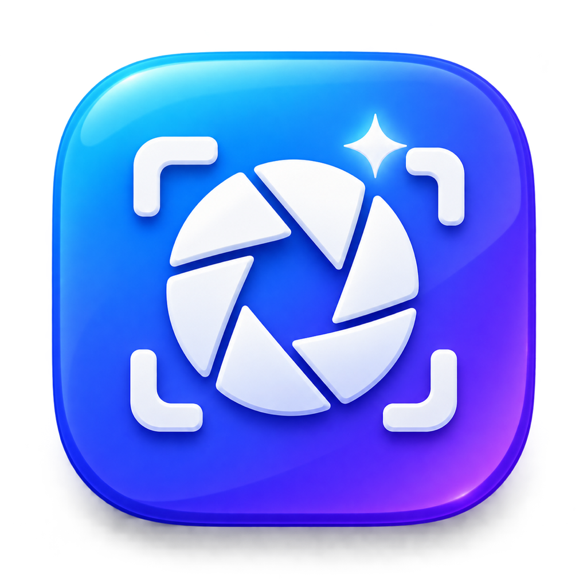

<div align="center">
  
  <h1>Clarishot</h1>
  <p><strong>Screenshots, screen recordings and annotation for macOS, from the menu bar.</strong></p>
  <p>Native Swift and AppKit · ScreenCaptureKit · Vision · open source (MIT)</p>
</div>

---

Clarishot lives in your menu bar. Press a shortcut, pick what to capture, and a small preview card
appears in the corner, ready to copy, save, annotate, pin or drag into another app. It also records
the screen (video or GIF), reads text out of images, and lets AI tools take screenshots through a
built-in MCP server.

## Features

**Capture**
- **Area, window, fullscreen and previous area**, with a crosshair, magnifier and size readout
- **All-In-One**: one shortcut, then choose Area, Fullscreen, Window, Smart, Scrolling, Timer, OCR or Recording from a bar
- **Smart Capture**: point at any part of an app (a button, sidebar or dialog) and click to capture exactly that element
- **Scrolling capture**: scroll a page and get one long, stitched image, with a live preview
- **Capture Object**: keep just the subject of an area on a transparent background
- **Capture Text (OCR)**: copy the text, and any QR code links, from part of the screen
- **Self-timer** with a red → orange → green countdown
- Window captures on your wallpaper, with padding and a shadow
- Save as **PNG, JPEG, WebP or AVIF**

**After capture**
- **Preview card** with Copy, Save, Annotate, Pin and drag-and-drop
- **Pinned screenshots** that float above other windows, with Paste, Lock and resize
- **Capture History**: a strip of recent captures, showing the app each came from

**Annotate**
- Arrows (straight or curved), shapes, filled boxes, text styles, highlighter, counters, pencil
- Blur, pixelate and spotlight
- **Hide Sensitive Info**: covers emails, phone numbers, card numbers, keys and labelled passwords in one click
- **Remove Background**, crop with aspect ratios and edge snapping, rotate and flip
- Backgrounds: gradients, colours or your wallpaper, with padding, rounded corners and presets

**Recording**
- Video or GIF, with system audio and microphone
- Camera bubble (circle, square, rectangle or vertical) that can go full screen
- Click highlights (size, colour, ripples) and on-screen keystrokes
- Pause, restart, countdown, dimming outside the area, and trimming afterwards
- Zoom editor: automatic zooms where you clicked, adjustable on a timeline, exported as a new movie

**Automation**
- **MCP server** so Claude Code, Claude Desktop, Cursor and other AI tools can take and read screenshots
- **`clarishot` command-line tool** for scripts
- **`clarishot://` links** for launchers such as Raycast or Alfred

## Requirements

- macOS 14 Sonoma or later
- Screen recording needs macOS 15 Sequoia or later
- The Liquid Glass look needs macOS 26 or later

## Install

Clarishot is currently built from source. You need Xcode 26 or later (or its command-line tools), because the code uses the macOS 26 SDK.

```bash
git clone https://github.com/Synced-Co/clarishot.git
cd clarishot
./scripts/build-app.sh
```

The script builds the app, copies it to `/Applications/Clarishot.app`, and you can open it from there.
For WebP output, install Google's WebP library first with `brew install webp`. The build bundles it inside the app.
More options are in the [developer guide](docs/DEVELOPMENT.md).

### Permissions

macOS asks for these the first time each feature is used:

| Permission | Needed for |
|---|---|
| Screen & System Audio Recording | Every screenshot and recording |
| Accessibility | Smart Capture, pin Paste, Auto-Scroll, keystroke display |
| Microphone / Camera | Only when you turn them on for a recording |

After allowing Screen Recording, quit and reopen Clarishot.

## Default shortcuts

Every shortcut can be changed or turned off in **Preferences → Shortcuts**. The defaults use
⌥⇧⌘ so they don't clash with macOS's own ⇧⌘3 / ⇧⌘4 / ⇧⌘5.

| Action | Shortcut |
|---|---|
| All-In-One | ⌥⇧⌘A |
| Capture Area | ⌥⇧⌘4 |
| Capture Previous Area | ⌥⇧⌘6 |
| Capture Fullscreen | ⌥⇧⌘3 |
| Capture Window | ⌥⇧⌘5 |
| Smart Capture | ⌥⇧⌘E |
| Capture Menu or Popover | ⌥⇧⌘M |
| Draw on Screen (while recording) | ⌥⇧⌘D |
| Capture Object (cutout) | ⌥⇧⌘1 |
| Capture & Annotate | ⌥⇧⌘7 |
| Capture Text (OCR) | ⌥⇧⌘2 |
| Scrolling Capture | ⌥⇧⌘S |
| Self-Timer | ⌥⇧⌘T |
| Record Screen / Stop | ⌥⇧⌘R |
| Pause / Resume Recording | ⌥⇧⌘P |

While selecting an area, hold **Space** to move it and press **Esc** to cancel.

## Use it with AI tools

Turn on **Preferences → Advanced → Allow AI tools & command line**, then add Clarishot to Claude Code:

```bash
claude mcp add --scope user clarishot -- /Applications/Clarishot.app/Contents/Helpers/clarishot mcp
```

Now you can ask things like *"take a screenshot of my Safari window and summarise it"*.
See [AI tools & command line](docs/AI_AND_CLI.md) for other apps, every tool and the `clarishot` command.

## Documentation

- [User guide](docs/USER_GUIDE.md): every feature and setting, step by step
- [AI tools & command line](docs/AI_AND_CLI.md): MCP server, `clarishot` CLI, `clarishot://` links
- [Developer guide](docs/DEVELOPMENT.md): building, project layout, how it works
- [Contributing](CONTRIBUTING.md)

## Privacy

Everything happens on your Mac. Text recognition, background removal and sensitive-info
detection use Apple's on-device Vision framework. Clarishot has no accounts, no analytics and no
cloud uploads. The AI and command-line connection is off by default and only accepts connections
from your own user account.

## Licence

[MIT](LICENSE) © 2026 Scott Mackey
